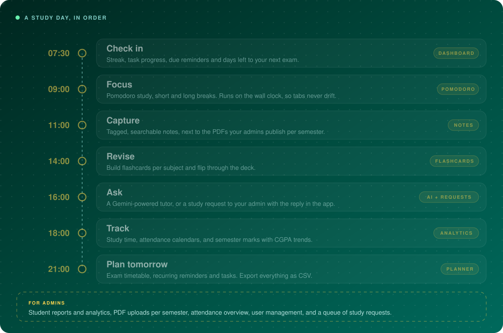
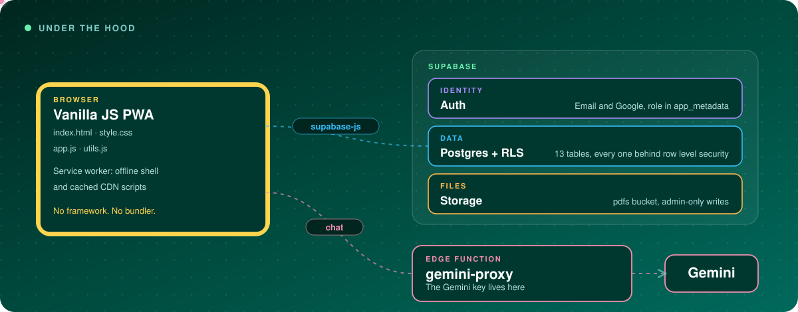

<div align="center">



<br />

**One installable app for the whole study day.**
Timetable, Pomodoro, flashcards, attendance, CGPA and an AI tutor, all offline-ready.

<br />

[**Open the app**](https://midhun-creator.github.io/studyplanner/) &nbsp;·&nbsp; [A study day](#a-study-day) &nbsp;·&nbsp; [Under the hood](#under-the-hood) &nbsp;·&nbsp; [Run it](#run-it) &nbsp;·&nbsp; [Roadmap](#roadmap)

<br />

`13 tables` &nbsp;·&nbsp; `every one behind RLS` &nbsp;·&nbsp; `12 unit tests` &nbsp;·&nbsp; `0 build steps` &nbsp;·&nbsp; `works offline`

</div>

<br />

## A study day

Most planners are a pile of features. StudyPlanner is arranged the way a student's day actually runs.

<div align="center">
  
</div>

<br />

## Under the hood

No framework and no bundler. Open `index.html` and it runs.

<div align="center">
  
</div>

<br />

<div align="center">

`JavaScript ES2020` &nbsp;·&nbsp; `Supabase` &nbsp;·&nbsp; `Chart.js 4.4` &nbsp;·&nbsp; `Gemini via Edge Function` &nbsp;·&nbsp; `GitHub Pages`

</div>

<br />

## Security

<div align="center">
  
</div>

<br />

<table>
<tr>
<td width="50%" valign="top">

**Admin is a server-side claim.**
The role lives in `app_metadata`, which users cannot edit, and no admin email ships in the source.

</td>
<td width="50%" valign="top">

**Students cannot forge replies.**
Only an admin can write a response to a study request.

</td>
</tr>
<tr>
<td valign="top">

**No raw HTML from users.**
Notes, requests and names are rendered with `textContent`.

</td>
<td valign="top">

**The Gemini key stays server-side.**
It lives in Edge Function secrets and never reaches the browser.

</td>
</tr>
</table>

The Supabase publishable key in `app.js` is public by design. RLS is what protects the data. Known gap: the CSP still allows inline handlers (see the roadmap).

<br />

## Run it

### Quick look

```bash
git clone https://github.com/midhun-creator/studyplanner.git
cd studyplanner
python3 -m http.server 8000      # or: npx serve .
```

Open http://localhost:8000.

### Connect your own Supabase

**1. Create the project.** Make a free [Supabase](https://supabase.com) project and put its URL and publishable key in `CONFIG` at the top of `app.js`.

**2. Create the schema.** Run [`supabase/schema.sql`](supabase/schema.sql) in the SQL Editor. It creates the tables, the `pdfs` bucket and every RLS policy.

**3. Turn on sign-in.** Under Authentication → Providers, enable Email and Google, and switch on **Confirm email**. Add your site URL to the redirect URLs.

**4. Make yourself admin.** Sign up, then run this and sign back in:

```sql
update auth.users
set raw_app_meta_data = coalesce(raw_app_meta_data, '{}'::jsonb) || '{"isAdmin": true}'
where email = 'you@example.com';
```

**5. Optional: the AI tutor.**

```bash
supabase functions deploy gemini-proxy
supabase secrets set GEMINI_API_KEY=<your-key>
```

Get a key at [Google AI Studio](https://aistudio.google.com/apikey).

### Test and deploy

```bash
npm test          # 12 unit tests, Node 18+
npm run check     # syntax check
```

Every push to `main` deploys to GitHub Pages. Enable **Settings → Pages → Source: GitHub Actions** once.

<details>
<summary><b>Keyboard shortcuts</b></summary>

<br />

Student view only, and not while typing.

| Keys | Action | Keys | Action |
|---|---|---|---|
| `Alt` `D` | Dashboard | `Alt` `P` | Pomodoro |
| `Alt` `T` | Timetable | `Alt` `K` | Tasks |
| `Alt` `R` | Reminders | `Alt` `C` | Chatbot |
| `Alt` `N` | Notes | | |

Deep links work too: `index.html#pomodoro`, `#tasks`, and the other section names.

</details>

<details>
<summary><b>Project layout</b></summary>

<br />

```
index.html   app shell and screens        sw.js          service worker
style.css    themes and components        manifest.json  PWA manifest
app.js       application logic            supabase/      schema and RLS
utils.js     pure helpers, unit-tested    tests/         node:test suite
icons/       PWA and social images        docs/          README art, project abstract
scripts/     publish.sh helper
```

</details>

<br />

## Roadmap

<table>
<tr>
<th width="50%" align="left">Next up</th>
<th width="50%" align="left">Later</th>
</tr>
<tr>
<td valign="top">

- [ ] Split `app.js` into ES modules
- [ ] Replace inline `onclick` handlers, then drop `'unsafe-inline'` from the CSP
- [ ] Integration tests for the Supabase flows

</td>
<td valign="top">

- [ ] Push notifications for reminders
- [ ] CSV and PDF export of study analytics
- [ ] Internationalisation

</td>
</tr>
</table>

<br />

## Where it came from

A minor project from the Department of Computer Hardware Engineering, Government Polytechnic College, Palakkad. Read the [original abstract](docs/project-abstract.pdf).

Built by Sajeeshna M, Maya P.M and Binnya D. Maintained by [Midhu](https://github.com/midhun-creator).

<br />

<div align="center">
  

<br />

[MIT License](LICENSE) &nbsp;·&nbsp; [Contributing](CONTRIBUTING.md) &nbsp;·&nbsp; [Changelog](CHANGELOG.md) &nbsp;·&nbsp; [Report a bug](https://github.com/midhun-creator/studyplanner/issues/new?template=bug_report.md)

</div>
